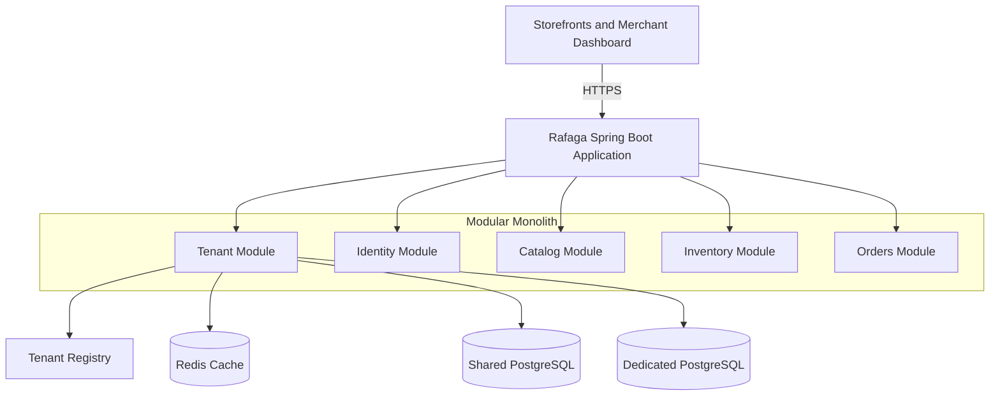

# Rafaga Backend

[](https://openjdk.org/)
[](https://spring.io/projects/spring-boot)
[](https://gradle.org/)
[](https://www.postgresql.org/)
[](https://redis.io/)
[](https://www.docker.com/)

Rafaga is a multi-tenant e-commerce SaaS backend built as a Java modular monolith. It supports an incremental tenant evolution from shared infrastructure to dedicated databases and dedicated application instances without forking business logic.

## Architecture



Each module follows `domain`, `application`, and `infrastructure` layers. The tenant application layer is organized by intent:

```text
application/
├── command/       # commands and input validation
├── exception/     # use-case errors
├── plan/          # plan feature defaults
├── port/          # infrastructure contracts
├── resolution/    # tenant resolution contract
└── service/       # use cases
```

## Modules

| Module | Responsibility |
| --- | --- |
| `common` | Cross-cutting contracts, including `TenantContext`. |
| `tenant` | Tenant registration, configuration, domains, feature flags, caching, and datasource routing. |
| `identity` | Identity, roles, and Keycloak/OIDC integration. |
| `catalog` | Products, categories, and variants. |
| `inventory` | Stock levels, movements, and reservations. |
| `orders` | Orders and their lifecycle. |

## Guides

- [Role and access strategy](docs/role-access-strategy.md)
- [API guide](docs/api.md)
- [Deployment guide](docs/deployment-guide.md)
- [Developer onboarding](docs/developer-onboarding.md)

## Requirements

- JDK 25
- Docker Desktop or Docker Engine with Compose v2
- Git

Gradle does not need to be installed globally; the repository includes the Gradle Wrapper.

## Quick start

Run the following commands from the `backend` directory.

```powershell
Copy-Item .env.example .env
docker compose up -d
docker compose run --rm postgres-role-setup
.\gradlew.bat bootRun
```

On macOS or Linux:

```bash
cp .env.example .env
docker compose up -d
docker compose run --rm postgres-role-setup
./gradlew bootRun
```

The default profile is `dev`. The backend listens on port `3117` unless `RAFAGA_SERVER_PORT` is set. The health endpoint is available at `GET /actuator/health`, and the OpenAPI documentation (dev only) is available at `http://localhost:3117/scalar` with the raw spec at `http://localhost:3117/v3/api-docs`.

For a production deployment, set `SPRING_PROFILES_ACTIVE=production`. Production accepts only `/actuator/health` and its Kubernetes probe groups without authentication; the remaining exposed actuator endpoints require the `SUPER_ADMIN` role and health responses never include component or detail data.

The development compose stack also starts Keycloak and imports the `rafaga` realm from `config/keycloak/import/rafaga-realm.json`. The realm includes the `platform-admin` user, the `SUPER_ADMIN`, `STORE_MANAGER`, and `CUSTOMER` roles, and the `tenant-demo` claim. Development-only Flyway migrations create the matching tenant, its feature flags, and a sample active catalog item (`DEMO-TEE`). Keycloak remains the sole source of roles; the local user projection is populated when a user authenticates.

To authenticate a local client, call the backend rather than Keycloak directly:

```powershell
$login = Invoke-RestMethod -Method Post `
  -Uri http://localhost:3117/api/public/auth/login `
  -Headers @{ Host = 'demo.rafaga.test' } `
  -ContentType 'application/json' `
  -Body '{"username":"platform-admin","password":"rafaga_dev_password"}'
$token = $login.accessToken
```

Use it with `Authorization: Bearer $token` for tenant-scoped endpoints. In dev, loopback hosts (`localhost`, `127.0.0.1`, `::1`) resolve to the `tenant-demo` tenant; use the `Host: demo.rafaga.test` header to exercise domain-based resolution. The Keycloak administration console is at `http://localhost:8080`; credentials are controlled through `.env`.

To stop the development environment:

```powershell
docker compose down
```

Development PostgreSQL data is stored in the `rafaga_postgres_data` volume.

## Testing

Tests use isolated infrastructure: PostgreSQL on port `5433` and Redis on port `6380`. The test database is ephemeral.
Keycloak is available on port `8081` with the same imported realm.

```powershell
docker compose -f compose.test.yaml up -d
docker compose -f compose.test.yaml run --rm postgres-role-setup-test
.\gradlew.bat test
docker compose -f compose.test.yaml down
```

`AuthenticationEndpointsIntegrationTest` waits for Keycloak's OIDC discovery endpoint, then exercises the public authentication endpoints against the Keycloak service from `compose.test.yaml`, including user registration, login, JWT validation, local synchronization, and domain-based tenant resolution.

Keycloak imports a realm only when it does not already exist. To apply changes to the checked-in realm definition during local development, remove the local stack with `docker compose down` and start it again.

The build automatically activates the Spring `test` profile. Datasource-routing integration tests use Testcontainers and also require Docker.

To run only the tenant module tests:

```powershell
.\gradlew.bat :modules:tenant:test
```

### Mandatory tenant-isolation checks

`CatalogApiIntegrationTest`, `InventoryApiIntegrationTest`, and `OrderApiIntegrationTest` are mandatory PostgreSQL-backed checks. They verify that tenant B cannot read or mutate tenant A data through the API and that the JPA query layer returns no cross-tenant records. New business modules that persist tenant data must add an equivalent integration test and include it in `.github/workflows/tenant-isolation.yml`.

Run the same gate locally after starting `compose.test.yaml`:

```powershell
.\gradlew.bat :test --tests com.rafaga.backend.CatalogApiIntegrationTest `
  --tests com.rafaga.backend.InventoryApiIntegrationTest `
  --tests com.rafaga.backend.OrderApiIntegrationTest
```

## Configuration

Local values can be overridden with environment variables.

| Variable | Default | Purpose |
| --- | --- | --- |
| `DB_SHARED_URL` | `jdbc:postgresql://localhost:5432/rafaga_shared` | Development shared PostgreSQL URL. |
| `DB_SHARED_USER` | `rafaga_runtime` | Restricted shared database user for application queries. |
| `DB_SHARED_PASSWORD` | `rafaga_runtime_dev` | Local development password for the restricted user. |
| `POSTGRES_USER` / `POSTGRES_PASSWORD` | `rafaga_app` / `rafaga_dev` | Database administrator used by Flyway and role setup, never for application queries. |
| `TEST_DB_SHARED_URL` | `jdbc:postgresql://localhost:5433/rafaga_test` | Test-profile PostgreSQL URL. |
| `TEST_DB_SHARED_USER` | `rafaga_test_runtime` | Restricted test database user for application queries. |
| `TEST_DB_SHARED_PASSWORD` | `rafaga_test_runtime` | Test password for the restricted user. |
| `TEST_POSTGRES_USER` / `TEST_POSTGRES_PASSWORD` | `rafaga_test` / `rafaga_test` | Test database administrator used by Flyway and role setup. |
| `TEST_REDIS_HOST` | `localhost` | Test Redis host. |
| `TEST_REDIS_PORT` | `6380` | Test Redis port. |
| `REDIS_HOST` / `REDIS_PORT` | `localhost` / `6379` | Development Redis host and port. |
| `REDIS_CONNECT_TIMEOUT` / `REDIS_TIMEOUT` | `2s` / `2s` | Redis connection and command timeouts. |
| `REDIS_CLUSTER_NODES` | — | Required production comma-separated `host:port` list for the Redis cluster. |
| `REDIS_CLUSTER_MAX_REDIRECTS` | `3` | Maximum redirects followed when Redis Cluster moves a slot. |
| `REDIS_SSL_ENABLED` | `true` | Enables TLS for the production Redis cluster; set according to the managed Redis service. |
| `KEYCLOAK_JWK_SET_URI` | Local Keycloak JWK endpoint | JWT public keys used by the resource server. |
| `KEYCLOAK_ISSUER_URI` | Local Keycloak realm URL | Keycloak issuer and OIDC endpoints. |
| `KEYCLOAK_CLIENT_ID` | — | Confidential client ID used only for direct Keycloak authentication. |
| `KEYCLOAK_CLIENT_SECRET` | — | Confidential client secret; provide it through the environment, never the repository. |
| `KEYCLOAK_ADMIN_CLIENT_ID` | `rafaga-backend-admin` | Service-account client used only by the backend to provision users. |
| `KEYCLOAK_ADMIN_CLIENT_SECRET` | — | Service-account client secret; provide it through the environment. |
| `RAFAGA_IDENTITY_REGISTRATION_TOKEN` | — | Global secret required by `POST /api/public/auth/register`; use a long random value. |
| `RAFAGA_ALLOWED_ORIGINS` | `http://localhost:3000` | Comma-separated static frontend origins accepted by CORS. |
| `KEYCLOAK_ADMIN_USERNAME` | `admin` | Local Keycloak bootstrap administrator. |
| `KEYCLOAK_ADMIN_PASSWORD` | — | Local Keycloak bootstrap administrator password. |

The `dev` profile targets local PostgreSQL, Redis and Keycloak, enables debug logs for tenant resolution and Spring Modulith, and enables the API documentation UI. The Gradle `test` profile uses the isolated PostgreSQL/Redis compose stack; some datasource-routing tests additionally start their own Testcontainers database. The `production` profile requires all database, Keycloak, CORS, registration-token, and Redis cluster variables above. It uses the restricted shared-database role for application traffic, validates Flyway migrations, uses a 50-connection Hikari pool, and never enables internal tenant-header resolution.

Dedicated-database credentials are never stored in `TenantConfig`. `TenantDatabaseCredentialsProvider` is the port used to integrate the appropriate secrets manager.
The `postgres-role-setup` services create or update the restricted application role and grant table access after PostgreSQL starts. Run them again after changing database credentials. PostgreSQL row-level security is enforced for application queries; Flyway uses the separate administrator connection.

## Database migrations

Flyway runs the historical V1-V9 scripts from `src/main/resources/db/migration` without renaming or editing them. Put future migrations in `db/migration/{module}/` and use the next version in one sequence shared by all modules. Flyway scans those subdirectories. Keep the migration SQL compatible with both shared and dedicated databases.

The V4 demo tenant seed is stored separately in `db/dev-migration` and is included by the `dev` profile. A new production or test database does not receive it. If an older database already has V4 in `flyway_schema_history`, startup includes the original V4 script for validation without re-executing it. Each database retains its own Flyway history.

Startup migrates the shared database first and then every registered `DEDICATED_DB` tenant. The first connection to a newly registered dedicated database also runs pending migrations before opening the runtime pool. A failed startup migration stops application startup; a failed lazy migration prevents that tenant connection from opening. Dedicated database migrations require a `TenantDatabaseCredentialsProvider` implementation that supplies restricted runtime credentials via `resolve` and separate schema-owner credentials via `resolveForMigration`. Provision the runtime PostgreSQL role with database connection access before migration. A dedicated tenant without these credentials cannot be served. Flyway creates the schema in the dedicated database, synchronizes its tenant row for the existing foreign keys, and grants table access to the runtime role while keeping `flyway_schema_history` inaccessible to it.

The platform registry tables `tenants`, `tenant_domains`, and `tenant_feature_flags` are read globally for domain resolution and tenant configuration, so they do not use tenant RLS. Business tables, including their association tables, use forced RLS based on `app.current_tenant`; the runtime database role must not own those tables or have `BYPASSRLS`.

## Tenant management API

Administrative tenant endpoints are available under `/api/admin/tenants`.

| Method | Path | Description |
| --- | --- | --- |
| `POST` | `/api/admin/tenants` | Registers a tenant and initializes its plan feature flags. |
| `GET` | `/api/admin/tenants` | Lists registered tenants. |
| `GET` | `/api/admin/tenants/{tenantId}` | Retrieves a tenant configuration. |
| `PUT` | `/api/admin/tenants/{tenantId}` | Updates tenant configuration, domains, or plan. |

Example request:

```json
{
  "name": "Demo Store",
  "domains": ["demo.rafaga.test"],
  "deploymentMode": "SHARED_DB",
  "planId": "starter"
}
```

For `DEDICATED_DB`, provide `databaseConfigId` as a secret reference. Never send or persist raw connection credentials in a request body.

These endpoints require the `SUPER_ADMIN` Keycloak role. They bypass tenant resolution because they operate at the platform level.

## Frontend authentication contract

Static frontends authenticate through the backend, not directly with Keycloak. Public endpoints are `POST /api/public/auth/login` and `POST /api/public/auth/register`. Registration requires a `SUPER_ADMIN` bearer token plus `username`, `firstName`, `lastName`, `email`, `password`, and the `X-Registration-Token` header, compared by the backend with the global `RAFAGA_IDENTITY_REGISTRATION_TOKEN` environment secret. The tenant is always resolved from the request domain; registration requests must not include a trusted `tenantId` field.

Keycloak is an internal dependency used by the backend for credential validation and user provisioning. Configure `RAFAGA_ALLOWED_ORIGINS` with the exact origins of the static frontends that may call this API.

The complete role matrix, tenant-crossing rules, onboarding flow, and authorization guidance are documented in [docs/role-access-strategy.md](docs/role-access-strategy.md).

## Database migrations

Flyway runs migrations during application startup. Hibernate runs with `ddl-auto=validate`, so schema changes must be delivered through versioned SQL migrations in `src/main/resources/db/migration`.

- `V1__create_modulith_event_publications.sql`
- `V2__create_tenant_management.sql`

## Common commands

```powershell
# Run the full test suite
.\gradlew.bat test

# Start the application
.\gradlew.bat bootRun

# Build the executable JAR
.\gradlew.bat bootJar

# Clean local build artifacts
.\gradlew.bat clean
```

## Contribution guidelines

- Communicate across modules through public APIs or events; never access another module's internal entities or repositories.
- Associate and validate all business data against `TenantContext`.
- Add or update the Flyway migration in the same change that modifies a persistent model.
- Run `./gradlew test` before creating a functional commit.
- Logs are structured JSON and include `tenantId`; never log passwords, OAuth tokens, registration tokens, payment data, or complete request headers.
- Use conventional commits: `feat(<module>):`, `test(<module>):`, `fix(<module>):`, `refactor(<module>):`, or `chore:`.
