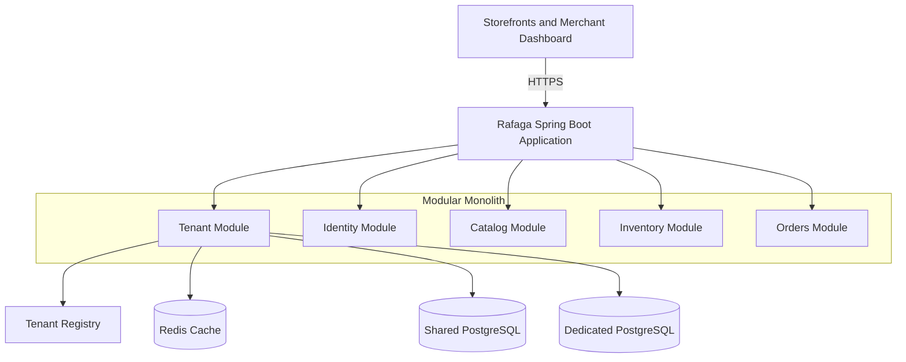

# Rafaga Backend

[](https://openjdk.org/)
[](https://spring.io/projects/spring-boot)
[](https://gradle.org/)
[](https://www.postgresql.org/)
[](https://redis.io/)
[](https://www.docker.com/)

Rafaga is a multi-tenant e-commerce SaaS backend built as a Java modular monolith. It supports an incremental tenant evolution from shared infrastructure to dedicated databases and dedicated application instances without forking business logic.

## Architecture



Each module follows `domain`, `application`, and `infrastructure` layers. The tenant application layer is organized by intent:

```text
application/
├── command/       # commands and input validation
├── exception/     # use-case errors
├── plan/          # plan feature defaults
├── port/          # infrastructure contracts
├── resolution/    # tenant resolution contract
└── service/       # use cases
```

## Modules

| Module | Responsibility |
| --- | --- |
| `common` | Cross-cutting contracts, including `TenantContext`. |
| `tenant` | Tenant registration, configuration, domains, feature flags, caching, and datasource routing. |
| `identity` | Identity, roles, and Keycloak/OIDC integration. |
| `catalog` | Products, categories, and variants. |
| `inventory` | Stock levels, movements, and reservations. |
| `orders` | Orders and their lifecycle. |

## Requirements

- JDK 25
- Docker Desktop or Docker Engine with Compose v2
- Git

Gradle does not need to be installed globally; the repository includes the Gradle Wrapper.

## Quick start

Run the following commands from the `backend` directory.

```powershell
Copy-Item .env.example .env
docker compose up -d
.\gradlew.bat bootRun
```

On macOS or Linux:

```bash
cp .env.example .env
docker compose up -d
./gradlew bootRun
```

The default profile is `dev`. The health endpoint is available at `GET /actuator/health`.

The development compose stack also starts Keycloak and imports the `rafaga` realm from `config/keycloak/import/rafaga-realm.json`. The realm includes the `platform-admin` user, the `PLATFORM_ADMIN` role, and the `tenant-demo` claim. The development database receives the matching `tenant-demo` tenant through a dev-only Flyway migration.

To authenticate a local client, call the backend rather than Keycloak directly:

```powershell
$login = Invoke-RestMethod -Method Post `
  -Uri http://localhost:8080/api/public/auth/login `
  -Headers @{ Host = 'demo.rafaga.test' } `
  -ContentType 'application/json' `
  -Body '{"username":"platform-admin","password":"rafaga_dev_password"}'
$token = $login.accessToken
```

Use it with `Authorization: Bearer $token` and the `Host: demo.rafaga.test` header for tenant-scoped endpoints. The Keycloak administration console is at `http://localhost:8082`; credentials are controlled through `.env`.

To stop the development environment:

```powershell
docker compose down
```

Development PostgreSQL data is stored in the `rafaga_postgres_data` volume.

## Testing

Tests use isolated infrastructure: PostgreSQL on port `5433` and Redis on port `6380`. The test database is ephemeral.
Keycloak is available on port `8081` with the same imported realm.

```powershell
docker compose -f compose.test.yaml up -d
.\gradlew.bat test
docker compose -f compose.test.yaml down
```

`AuthenticationEndpointsIntegrationTest` waits for Keycloak's OIDC discovery endpoint, then exercises the public authentication endpoints against the Keycloak service from `compose.test.yaml`, including user registration, login, JWT validation, local synchronization, and domain-based tenant resolution.

Keycloak imports a realm only when it does not already exist. To apply changes to the checked-in realm definition during local development, remove the local stack with `docker compose down` and start it again.

The build automatically activates the Spring `test` profile. Datasource-routing integration tests use Testcontainers and also require Docker.

To run only the tenant module tests:

```powershell
.\gradlew.bat :modules:tenant:test
```

## Configuration

Local values can be overridden with environment variables.

| Variable | Default | Purpose |
| --- | --- | --- |
| `DB_SHARED_URL` | `jdbc:postgresql://localhost:5432/rafaga_shared` | Development shared PostgreSQL URL. |
| `DB_SHARED_USER` | `rafaga_app` | Shared database user. |
| `DB_SHARED_PASSWORD` | `rafaga_dev` | Local development password. |
| `TEST_DB_SHARED_URL` | `jdbc:postgresql://localhost:5433/rafaga_test` | Test-profile PostgreSQL URL. |
| `TEST_DB_SHARED_USER` | `rafaga_test` | Test database user. |
| `TEST_DB_SHARED_PASSWORD` | `rafaga_test` | Test database password. |
| `TEST_REDIS_HOST` | `localhost` | Test Redis host. |
| `TEST_REDIS_PORT` | `6380` | Test Redis port. |
| `KEYCLOAK_JWK_SET_URI` | Local Keycloak JWK endpoint | JWT public keys used by the resource server. |
| `KEYCLOAK_ISSUER_URI` | Local Keycloak realm URL | Keycloak issuer and OIDC endpoints. |
| `KEYCLOAK_CLIENT_ID` | — | Confidential client ID used only for direct Keycloak authentication. |
| `KEYCLOAK_CLIENT_SECRET` | — | Confidential client secret; provide it through the environment, never the repository. |
| `KEYCLOAK_ADMIN_CLIENT_ID` | `rafaga-backend-admin` | Service-account client used only by the backend to provision users. |
| `KEYCLOAK_ADMIN_CLIENT_SECRET` | — | Service-account client secret; provide it through the environment. |
| `RAFAGA_IDENTITY_REGISTRATION_TOKEN` | — | Global secret required by `POST /api/public/auth/register`; use a long random value. |
| `RAFAGA_ALLOWED_ORIGINS` | `http://localhost:3000` | Comma-separated static frontend origins accepted by CORS. |
| `KEYCLOAK_ADMIN_USERNAME` | `admin` | Local Keycloak bootstrap administrator. |
| `KEYCLOAK_ADMIN_PASSWORD` | — | Local Keycloak bootstrap administrator password. |

Dedicated-database credentials are never stored in `TenantConfig`. `TenantDatabaseCredentialsProvider` is the port used to integrate the appropriate secrets manager.

## Tenant management API

Administrative tenant endpoints are available under `/api/admin/tenants`.

| Method | Path | Description |
| --- | --- | --- |
| `POST` | `/api/admin/tenants` | Registers a tenant and initializes its plan feature flags. |
| `GET` | `/api/admin/tenants` | Lists registered tenants. |
| `GET` | `/api/admin/tenants/{tenantId}` | Retrieves a tenant configuration. |
| `PUT` | `/api/admin/tenants/{tenantId}` | Updates tenant configuration, domains, or plan. |

Example request:

```json
{
  "name": "Demo Store",
  "domains": ["demo.rafaga.test"],
  "deploymentMode": "SHARED_DB",
  "planId": "starter"
}
```

For `DEDICATED_DB`, provide `databaseConfigId` as a secret reference. Never send or persist raw connection credentials in a request body.

These endpoints require the `PLATFORM_ADMIN` Keycloak role. They bypass tenant resolution because they operate at the platform level.

## Frontend authentication contract

Static frontends authenticate through the backend, not directly with Keycloak. Public endpoints are `POST /api/public/auth/login` and `POST /api/public/auth/register`. Registration requires `username`, `firstName`, `lastName`, `email`, `password`, and the `X-Registration-Token` header, compared by the backend with the global `RAFAGA_IDENTITY_REGISTRATION_TOKEN` environment secret. The tenant is always resolved from the request domain; registration requests must not include a trusted `tenantId` field.

Keycloak is an internal dependency used by the backend for credential validation and user provisioning. Configure `RAFAGA_ALLOWED_ORIGINS` with the exact origins of the static frontends that may call this API.

## Database migrations

Flyway runs migrations during application startup. Hibernate runs with `ddl-auto=validate`, so schema changes must be delivered through versioned SQL migrations in `src/main/resources/db/migration`.

- `V1__create_modulith_event_publications.sql`
- `V2__create_tenant_management.sql`

## Common commands

```powershell
# Run the full test suite
.\gradlew.bat test

# Start the application
.\gradlew.bat bootRun

# Build the executable JAR
.\gradlew.bat bootJar

# Clean local build artifacts
.\gradlew.bat clean
```

## Contribution guidelines

- Communicate across modules through public APIs or events; never access another module's internal entities or repositories.
- Associate and validate all business data against `TenantContext`.
- Add or update the Flyway migration in the same change that modifies a persistent model.
- Run `./gradlew test` before creating a functional commit.
- Use conventional commits: `feat(<module>):`, `test(<module>):`, `fix(<module>):`, `refactor(<module>):`, or `chore:`.
