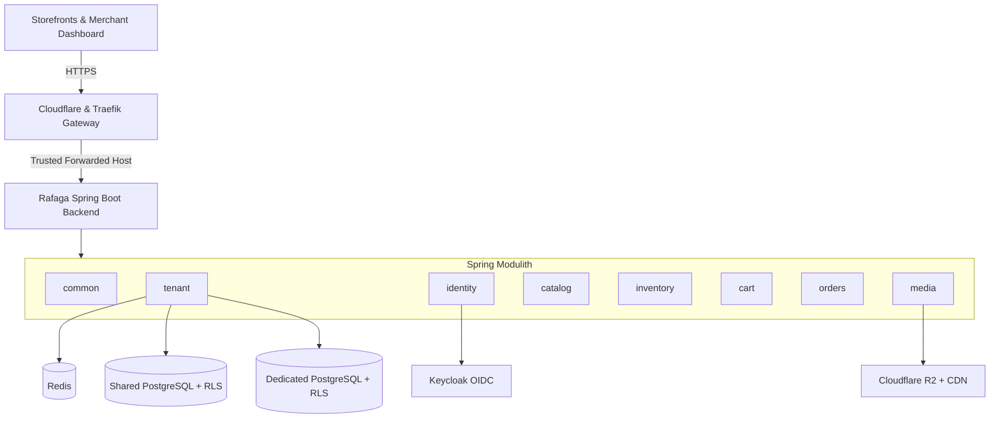
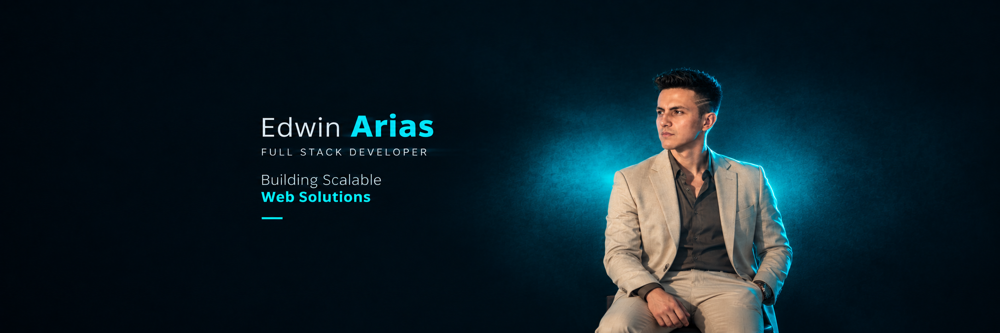

# Rafaga Backend

[](https://openjdk.org/)
[](https://spring.io/projects/spring-boot)
[](https://spring.io/projects/spring-modulith)
[](https://gradle.org/)
[](https://www.postgresql.org/)
[](https://redis.io/)
[](LICENSE)

Rafaga is a multi-tenant e-commerce SaaS backend built as a Java modular monolith. It supports incremental tenant scaling — from shared infrastructure (`SHARED_DB`) to dedicated PostgreSQL databases (`DEDICATED_DB`) and dedicated application instances (`DEDICATED_INSTANCE`) — without forking business logic.

> [!NOTE]
> All tenants start on the shared PostgreSQL database with forced Row-Level Security (RLS) and can graduate to a dedicated database or dedicated instance at runtime through the super-admin control plane, with zero downtime and instant rollback.

## Table of Contents

- [Architecture](#architecture)
- [Modules](#modules)
- [Prerequisites](#prerequisites)
- [Quick Start](#quick-start)
- [Testing](#testing)
- [Documentation](#documentation)
- [Contributing](#contributing)
- [License](#license)

## Architecture



Each module is structured in `domain`, `application`, and `infrastructure` layers, with cross-module dependencies restricted to `@NamedInterface("api")` contracts and domain events. See [Architecture Overview](docs/architecture/overview.md) for full details.

## Modules

| Module | Responsibility |
| --- | --- |
| `common` | Cross-cutting abstractions: `TenantContext`, `JobOutcomeRegistry`, `CorrelationIdPropagation`, and shared domain events. |
| `tenant` | Tenant registry, domain lifecycle & Cloudflare provisioning, feature flags, deployment targets, controlled transitions, caching, and datasource routing. |
| `identity` | Keycloak OIDC integration, JWT validation (`iss`/`aud`/roles), layered rate limiting, and user profile synchronization. |
| `catalog` | Products, categories, and variants. |
| `inventory` | Stock levels, movements, and ShedLock-guarded reservation expiry. |
| `cart` | Guest and storefront shopping carts and checkout orchestration. |
| `orders` | Order creation, status transitions, and domain event publication. |
| `media` | Direct-to-R2 presigned uploads, tenant media quotas, and cleanup/reconciliation jobs. |

## Prerequisites

- **JDK 25**
- **Docker** with Compose v2
- **Git**

Gradle is bundled via the Gradle Wrapper (`./gradlew` / `.\gradlew.bat`).

## Quick Start

From the `backend` directory:

```bash
# macOS / Linux
cp .env.example .env
docker compose up -d
docker compose run --rm postgres-role-setup
./gradlew bootRun
```

```powershell
# Windows (PowerShell)
Copy-Item .env.example .env
docker compose up -d
docker compose run --rm postgres-role-setup
.\gradlew.bat bootRun
```

> [!TIP]
> In the `dev` profile (port `3117`), interactive OpenAPI docs are available at `http://localhost:3117/scalar` (raw spec at `/v3/api-docs`), health at `/actuator/health`, and the local Keycloak admin console at `http://localhost:8080`.

Stop the local stack with `docker compose down`. For local authentication examples and full setup instructions, see [Developer Onboarding](docs/getting-started/developer-onboarding.md).

> [!WARNING]
> Never commit `.env` files or real credentials. In production (`SPRING_PROFILES_ACTIVE=production`), secrets must be injected via your deployment platform or mounted secret files; see [Production Secrets & Rotation](docs/security/production-secrets-and-rotation.md).

## Testing

Tests run against an isolated Docker Compose stack (`compose.test.yaml`: PostgreSQL on `5433`, Redis on `6380`, Keycloak on `8081`):

```bash
docker compose -f compose.test.yaml up -d --wait postgres-test redis-test keycloak-test
docker compose -f compose.test.yaml run --rm postgres-role-setup-test
./gradlew test
docker compose -f compose.test.yaml down
```

> [!IMPORTANT]
> Always run `postgres-role-setup-test` after starting a fresh test database so the restricted runtime role (`NOSUPERUSER NOBYPASSRLS`) and forced RLS policies are active. Cross-tenant isolation tests and Spring Modulith boundary tests are mandatory CI gates.

For targeted test suites, Testcontainers requirements, and CI jobs, see the [Testing Guide](docs/getting-started/testing.md).

## Documentation

The full documentation is organized under [`docs/`](docs/README.md):

| Section | Contents |
| --- | --- |
| [Getting Started](docs/README.md#getting-started) | Local onboarding and testing guide |
| [Architecture](docs/README.md#architecture) | Modular monolith design, multi-tenancy, and Flyway migrations |
| [API](docs/README.md#api) | Storefront, backoffice, and super-admin API contracts |
| [Configuration](docs/README.md#configuration) | Environment variables, profiles, and rate-limit tuning |
| [Security](docs/README.md#security) | Role access strategy, secrets & rotation, and PKCE migration plan |
| [Operations](docs/README.md#operations) | Deployment, dedicated DB runbook, R2/CDN setup, and production contracts |

## Contributing

Read [CONTRIBUTING.md](CONTRIBUTING.md) before opening a pull request. All changes must respect Spring Modulith boundaries, multi-tenant isolation checks, and conventional commits.

## License

This project is licensed under the [MIT License](LICENSE).

---

<div align="center">



<br />

**Built & maintained by [@edwin-dev31](https://github.com/edwin-dev31)**

[](https://github.com/edwin-dev31)

</div>
